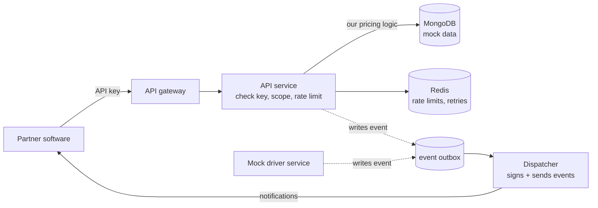

# Initial Setup Report (P1)

**Course:** COMP 8967, University of Windsor, Fall 2026
**Business:** Aerrand Technologies Inc. (Business 3) | **Group:** 6
**Team name:** Aerrand Group-6

## 1. Project Details

### Challenge Description

Aerrand is a Windsor startup that makes buying and selling used items safer. Instead of two
strangers meeting up, a vetted local driver verifies the item, picks it up, and delivers it.
The problem they gave us is this: right now, any business that wants Aerrand to run a delivery
has to log into Aerrand's dashboard and fill out a form by hand. Aerrand wants partners (like
online stores or marketplaces) to be able to do that straight from their own software instead.

The way that happens is through an API key, which is basically a secret token that lets a
partner's code prove who it is and book a delivery automatically. Our job is to build that key
system plus a clean public API around it. The tricky part is doing it safely. Today the price
of a delivery is sent from the browser and the server just trusts it, which is fine when only
Aerrand's own dashboard is calling. The moment outside code can call in, that becomes a hole,
so the server has to work out the price itself.

For this phase we're building a standalone version against mock/sample data rather than wiring
into Aerrand's live system. A few pieces are simplified to match that scope: we build a simple
wallet instead of connecting to their real one, and because API keys are sensitive they are
issued through a secure, controlled process rather than handed out on a public dashboard.

### Solution Approach

**Architecture and design.** We build the API as its own service with its own database, so it
stays separate from the kind of internal code that was never meant to face the public. A
request flows like this:

A few design choices and the trade-offs behind them:

- We keep the API as its own locked-down service so a key can book a delivery but can't reach
  anything else. This duplicates a little bit of setup, but it keeps the public surface small
  and safe.
- The server recalculates every price itself instead of trusting the caller. That costs one
  extra step, but it closes the "book a delivery for 50 cents" problem.
- For notifications (webhooks), the hard part is that driver updates come from a separate
  service. We looked at having the API constantly check the database, but that's slow and
  misses quick changes. Instead, both the API and the (mock) driver service write a small event
  row to a shared table, and a background worker reads that table and sends the signed
  notification. It's simpler to test and needs no extra infrastructure beyond one worker.

**Implementation strategy.** We work in one-week sprints and try to finish one working piece
end to end each time, instead of building everything half-way at once. Rough milestones:

- Weeks 1–2: project setup, database, the API gateway, a health check.
- Weeks 3–4: key creation and checking, plus the price-quote endpoint.
- Weeks 5–6: booking a delivery and paying from the simple wallet, with tracking.
- Weeks 7–8: webhooks and a test/sandbox mode.
- Weeks 9+: safety features (rate limits, retry protection) and developer docs.

### Technologies Chosen

Aerrand's live system runs on Django, Node and MongoDB. Since this phase uses mock data and
isn't connected to production, we build a standalone version and simulate the driver side, but
we match their stack where it's sensible so the work could transfer later.

| Technology | Why we're using it | Alternative we skipped |
|-----------|--------------------|------------------------|
| Python / Django + DRF | Matches Aerrand's backend; good for building REST APIs | FastAPI/Flask, but this keeps us aligned with their stack |
| MongoDB (own instance, mock data) | Same database Aerrand uses, so our work can transfer | PostgreSQL, but it wouldn't match their system |
| Node.js (mock driver service) | Simulates the real Node driver backend that sends updates | n/a |
| Redis | Needed for rate limiting and retry state across workers | In-memory cache breaks with multiple workers |
| Docker Compose | Runs all the services together locally and on a server | Kubernetes is overkill here |
| GitHub + Actions | Our repo, issue board, and automated checks | GitLab, but team is on GitHub |
| OpenAPI + Redoc | Auto-generated API docs for partners | Hand-written docs drift out of date |

## 2. Team Details

**Team name:** Aerrand Group-6

Work is split evenly across the four of us by area, and everyone writes code. We review each
other's pull requests, so each person also touches parts outside their main area.

| Member | GitHub | Role / main area |
|--------|--------|------------------|
| Nikhil Goud Nathi | @nikhilnathi2003 | API keys, authentication, integration |
| Sujith Chitram | @sujithchitram24 | Price quotes and delivery booking |
| Venkata Charan Sai Doniparthi | @charansai50 | Simple wallet payment and webhooks |
| Sai Srinivas Uppara | @Lucky100704 | Tracking/cancellation, developer docs, test mode |

Short bios (edit anything that isn't accurate for you):

- **Nikhil Goud Nathi** — Master of Applied Computing student; works on backend development and
  application security, mainly with Python and Django.
- **Sujith Chitram** — Master of Applied Computing student; works on backend and API
  development with Python and databases.
- **Venkata Charan Sai Doniparthi** — Master of Applied Computing student; interested in backend
  services and payment/notification integrations, with Python and Node.js.
- **Sai Srinivas Uppara** — Master of Applied Computing student; works on backend, testing and
  documentation for REST APIs.

*Add a headshot next to each name in the final document.*

**Contribution plan.** Each person owns their area from design through code and tests. The
shared pieces (rate limiting, retry protection, keeping one business's data separate from
another's) are split between pairs and reviewed by everyone. Our GitHub issues are labelled by
area, so it's easy to see who's doing what and that the load is even.

## 3. Team Agreements

- **Primary contact:** Nikhil Goud Nathi.
- **Communication:** MS Teams, in the *Business 3 - Group 6* channel, with our GA Rustem
  Izmailov in the chat.
- **Project management:** a GitHub Projects board. We've set up the repo and broken the
  requirements into tasks on the board, each with an owner and a status, grouped by area.
- **Contingency planning:**
  - If a member drops the course, we split their open issues among the rest at the next sprint
    planning and tell the GA so scope can be adjusted.
  - If someone keeps missing meetings or deadlines, we talk to them directly first; if it keeps
    happening we raise it with the GA and rebalance the board so work isn't blocked.
  - For academic honesty, all work goes through reviewed pull requests with a clear commit
    history, so each person's contribution is traceable. Anything suspicious gets raised with
    the GA and then the instructor.

## 4. Kickoff Meeting Summary

**Business contact:** Johnpaul Sani, Founder and CEO, Aerrand Technologies Inc.

**Questions our team asked and the answers Johnpaul gave:**

- *(Nikhil)* Will we be working with your real system, or a separate sandbox with sample data?
  **Answer:** We'll use mock data, not the live production system.
- *(Nikhil)* Is there an existing wallet system we'd connect to, or should we build a simple
  one? **Answer:** Don't connect to the existing wallet; build a simple version for now.
- *(Nikhil)* How would partners receive their API keys, through a dashboard or issued manually
  at first? **Answer:** API keys are sensitive, so they won't be handed out through a dashboard;
  they'll be issued through a secure, controlled process at first.
- *(Teammate)* Should the new API be its own PostgreSQL service, or share the existing MongoDB?
  **Answer:** He left this open. For our standalone build we'll use MongoDB (our own instance
  with mock data), since it's Aerrand's database and keeps our work transferable.

**Reflection.** Going in, we thought of this mostly as "build some API endpoints." After the
meeting it's clearer that the focus for this phase is a safe, standalone build on mock data,
with a few parts simplified (the wallet, and how keys are handed out). The parts that actually
need thought are getting the price right on the server and getting driver updates out through
the event system, not the endpoints themselves. That changed what we plan to build first.

## 5. Sprint Plan (one week = one sprint)

**User stories**

- As a partner developer, I want to be issued an API key securely so my software can connect to
  Aerrand.
- As a partner's system, I want to get a price quote for a route so I know the cost before
  booking.
- As a partner's system, I want to book a delivery in one call and have it paid from our wallet
  so no one has to click "pay" by hand.
- As a partner developer, I want to get a notification when the delivery status changes so I
  don't have to keep checking.
- As Aerrand, I want every key stored safely and revocable instantly so a leaked key does no
  damage.

**Task breakdown for the first four sprints**

| Sprint | Focus | Tasks |
|--------|-------|-------|
| 1 | Setup | Finish this report; set up Docker + Redis; create the API service skeleton; add a health check; turn on automated checks in GitHub |
| 2 | Keys and login | Build the key model (stored as a hash); check keys on each request; secure create/revoke process; write tests |
| 3 | Quotes | Build the quote endpoint with server-side pricing; calculate route distance; save quotes with an expiry; add input validation |
| 4 | Booking and payment | Build the create-delivery endpoint (single and multi-stop); pay from the simple wallet safely; add get/track endpoints; prevent duplicate bookings |

## 6. Other Details

**Risks and assumptions.** The webhook part is the riskiest because it spans two services, so
we'll prototype it early and test it hard. Pricing has to be correct and consistent, so we'll
test it against fixed sample routes. We're assuming the mock data and simple wallet are enough
to demonstrate the full flow this phase, and that we can revisit real integration later. We're
also assuming the scope stays roughly as discussed in the kickoff.

**Ethical considerations.** Even with mock data, the system is designed around real personal
information (names, phone numbers, addresses) and payments, so we build the safe habits in from
the start: personal info is never written to logs or error reports, API keys are only ever
stored as a hash and never in plain text, webhook secrets are encrypted, and each business can
only ever see its own deliveries. Outgoing webhook requests are checked so they can't be abused
to reach internal addresses. The design follows Canadian privacy rules (PIPEDA).

**Links.**
- Repo: https://github.com/nikhilnathi2003/aerrand-developer-api
- Board: https://github.com/users/nikhilnathi2003/projects/2
