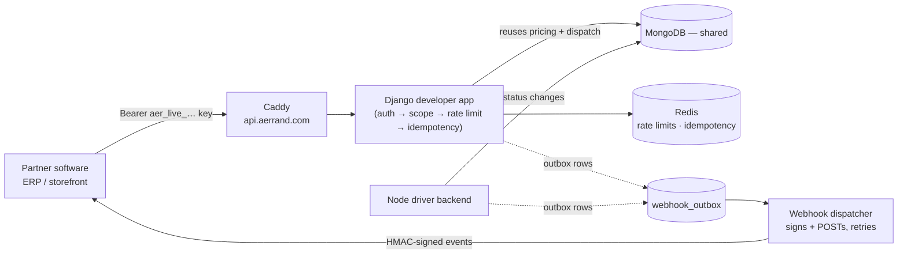

# Initial Setup Report (P1)

**Course:** COMP 8967 — University of Windsor, Fall 2026
**Business:** Aerrand Technologies Inc. (Business 3) · **Group:** 6
**Team name:** _[FILL: pick one — see suggestions at bottom]_

> ⚠️ Hard limit: **3 pages.** This markdown is the working draft; trim the examples/placeholders
> before exporting to the 3-page submission. Items in **[FILL: …]** need a human.

---

## 1. Project Details

### Challenge Description (our words)
Aerrand is a Windsor startup that makes buying and selling secondhand items safe: instead of
meeting a stranger, a vetted local driver ("Aerrander") verifies, picks up, and delivers the
item. Today, a business that wants Aerrand to run a delivery has to log into Aerrand's
dashboard and fill in a form by hand. Our challenge is to build the **API key infrastructure
and a public API (`api.aerrand.com/v1`)** that lets a partner's *software* do this
automatically — the same way a checkout page offers "Log in with Google" instead of building
its own login. The core difficulty is doing it safely: today the delivery price is sent from
the browser and trusted by the server, which is fine for Aerrand's own dashboard but unsafe
the moment outside code can call in. So the server must compute price itself, keys must be
authenticated and revocable, and the new API must be a **separate, locked-down front door**
that reuses Aerrand's existing pricing and dispatch logic without exposing the legacy system.

### Solution Approach

**Architecture & Design.** We add a new public host and a new, isolated Django app rather
than bolting keys onto existing endpoints. The request flow:

*Explanation & trade-offs:*
- **Separate host/app vs. reusing legacy endpoints** — we isolate the public surface so a key
  can book but can't reach the legacy `AllowAny` routes. Trade-off: some duplicated routing,
  but zero risk to the live dashboard/driver apps.
- **Server-trusted pricing vs. client price** — the server recomputes every price from the
  stops + routed distance. Trade-off: an extra pricing call, in exchange for closing the
  "book a delivery for $0.50" hole.
- **Webhooks via a transactional outbox vs. polling / change streams** — driver events happen
  in the Node service, which Django can't observe directly. Both services write event rows to
  a shared `webhook_outbox`; a background dispatcher signs and delivers them with retries. We
  chose this over polling (laggy, misses states) and Mongo change streams (brittle) because it
  is explicit, testable, and adds no new infrastructure beyond one worker process.

**Implementation Strategy (milestones & deliverables).** We work in **1-week sprints**,
delivering one working vertical slice at a time, mirroring Aerrand's own 5-phase rollout:
- **M0 – Foundations:** repo, Docker Compose + Redis, Caddy host, DB migrations, health check.
- **M1 – Keys + Quotes:** key issuance/auth/scopes, `POST /v1/quotes` with server pricing.
- **M2 – Booking + Payment:** `POST /v1/aerrands` (atomic multi-stop), wallet debit, reads.
- **M3 – Webhooks + Test mode:** outbox writers, dispatcher, retries, sandbox keys.
- **M4 – Safety + Docs:** idempotency, rate limiting, tenant isolation, OpenAPI docs.

### Technologies Chosen

| Technology | Why | Alternatives (and why not) |
|-----------|-----|----------------------------|
| **Python / Django + DRF** | Aerrand's backend is already Django; we must integrate, not rewrite | FastAPI/Flask — would fragment the stack |
| **Node.js** | The driver backend is Node; webhook outbox writes live there | — (dictated by existing system) |
| **MongoDB** | Shared DB used by all Aerrand backends | Postgres — not an option mid-system |
| **Redis** | Rate limiting + idempotency need shared, fast state | In-process cache — breaks across workers |
| **Caddy** | Existing reverse proxy; auto-TLS for the new host | Nginx — Aerrand already standardized on Caddy |
| **Docker Compose** | Matches Aerrand's single-droplet deployment | k8s — overkill for this scale |
| **Stripe** | Existing payment provider (wallet top-ups, checkout) | — |
| **GitHub + GitHub Actions** | Repo, issues/board (PM), CI | GitLab — team already on GitHub |
| **OpenAPI 3.1 + Redoc** | Required developer docs; "integrate in an afternoon" goal | Hand-written docs — drift from the API |

---

## 2. Team Details

**Team name:** _[FILL]_

**Members** — _[FILL for each member: full name · short bio (academic background + technical
strengths) · GitHub username · role · headshot]_. Note the rubric: start with the team leader,
**and every member must contribute to coding.**

| # | Full name | Bio (background + strengths) | GitHub | Role |
|---|-----------|------------------------------|--------|------|
| 1 (lead) | Nikhil Nathi | _[FILL bio]_ | @nikhilnathi2003 | Team Lead + Backend (keys/auth) |
| 2 | _[FILL]_ | _[FILL]_ | _[@FILL]_ | _[FILL — e.g. Pricing/Booking]_ |
| 3 | _[FILL]_ | _[FILL]_ | _[@FILL]_ | _[FILL — e.g. Webhooks/Outbox]_ |
| 4 | _[FILL]_ | _[FILL]_ | _[@FILL]_ | _[FILL — e.g. Dashboard UI/Docs]_ |

_(Headshots: insert each member's photo next to their row in the final document.)_

**Contribution Plan.** Work is divided by the project's **pillars**, so each member owns a
coherent slice end-to-end (design → code → tests) while pairing on shared pieces:
- **Keys & Auth** (member 1) · **Pricing & Booking** (member 2) · **Webhooks & Outbox**
  (member 3) · **Dashboard UI & Docs** (member 4). Safety rails (idempotency, rate limits,
  tenant isolation) are shared and reviewed by all. Every PR is reviewed by at least one other
  member, so everyone touches multiple areas. Our 102 GitHub issues are labeled by pillar so
  ownership is visible and contribution is measurable.

---

## 3. Team Agreements

- **Primary Contact (with GA & instructor):** _[FILL — one member, likely the team lead]_
- **Communication Tool:** **MS Teams** (channel *Business 3 - Group 6*), with our GA
  **Rustem Izmailov** included in the chat.
- **Project Management Tool:** **GitHub Projects + Issues.** We have already created a private
  repo with **102 issues** (one per requirement), labeled by priority (MoSCoW), pillar, and
  phase, grouped under 5 phase **milestones** with progress tracking.
  Repo: `https://github.com/nikhilnathi2003/aerrand-developer-api`
- **Contingency Planning:**
  - *A member drops the course:* their open issues are redistributed by pillar at the next
    sprint planning; we notify the GA immediately and adjust scope with the business if needed.
  - *A member misses meetings/deadlines:* first a direct check-in; if it continues, the lead
    raises it with the GA and we rebalance the board so delivery isn't blocked.
  - *Academic dishonesty:* all work goes through reviewed PRs with traceable commit history; any
    suspected plagiarism or AI-misuse is escalated to the GA, then the instructor. No code is
    merged without attribution to its author.

---

## 4. Kickoff Meeting Summary

- **Business Contact:** **Johnpaul Sani** — Founder & CEO, Aerrand Technologies Inc.
  (Mentor/GA: Rustem Izmailov.)
- **Our Q&A** — _[FILL with the actual questions your group asked and the answers given.
  Likely candidates from our analysis, confirm which you actually asked:]_
  - _Do we get access to the existing `Aerrand_backen_infra` codebase, or build to spec? →_ **[answer]**
  - _Is `STRIPE_SECRET_KEY_BUSINESS` moving to a live key before go-live? →_ **[answer]**
  - _Can we get a sandbox business account + test wallet to develop against? →_ **[answer]**
  - _Should API aerrands use channel `"api"` vs reusing `"business"`? →_ **[answer]**
- **Other groups' questions (with answers):** _[FILL — list the useful ones you recorded]_
- **Reflection:** _[FILL — 2–3 sentences. Draft to adapt:]_ Before the meeting we saw this as
  "build an API." After it, we understand the real constraint is **integrating safely into a
  live production system** — the hard parts are pricing integrity and delivering driver-side
  events across two services, not the endpoints themselves. Our priorities shifted toward the
  outbox design and server-side pricing first.

---

## 5. Sprint Plan (1 week = 1 sprint; first 4 sprints)

**User Stories**
- As a **partner developer**, I want to **generate a scoped API key from the dashboard** so
  that **my software can authenticate to Aerrand securely.**
- As a **partner's system**, I want to **request a price quote for a route** so that **I know
  the exact cost before booking.**
- As a **partner's system**, I want to **create a delivery in one call and have it paid from
  our wallet** so that **no human has to click "pay."**
- As a **partner developer**, I want to **receive a webhook when the status changes** so that
  **I don't have to poll for updates.**
- As **Aerrand**, I want **every key hashed and instantly revocable** so that **a leaked key
  causes zero damage.**

**Task Breakdown**

| Sprint | Focus | Tasks (technical + non-technical) |
|--------|-------|-----------------------------------|
| **1** | Setup & foundations | Create repo/board (done); finalize this report; Docker Compose + Redis; new Django `developer` app skeleton; `GET /v1/health`; CI on GitHub Actions |
| **2** | Keys & auth | `ApiKey` model (hashed + scoped); `ApiKeyAuthentication`; create/revoke/rotate endpoints; dashboard "Developers" section (keys only); unit tests |
| **3** | Quotes & pricing | `POST /v1/quotes` reusing the pricing engine; route-km calc; quote persistence + expiry; validation errors; parity test vs dashboard estimate |
| **4** | Booking & payment | `POST /v1/aerrands` (atomic, single + multi-stop); server-side price; atomic wallet debit; `GET /v1/aerrands/{id}` + tracking; idempotency key on create |

---

## 6. Other Details

- **Risks & Assumptions:**
  - *Risk:* we may not get the real codebase → *Mitigation:* build to the spec's interfaces so
    our code can be lifted into Aerrand's monorepo later.
  - *Risk:* the webhook outbox spans two services (Django + Node) → *Mitigation:* prototype it
    early and cover it heavily with tests.
  - *Risk:* pricing must match the dashboard to the cent → *Mitigation:* adopt Aerrand's parity
    test as an acceptance gate.
  - *Assumptions:* we have a test/sandbox business + wallet; Aerrand's existing pricing and
    dispatch logic are stable and reusable; Redis can be added to the compose stack.
- **Ethical Considerations:** The system handles **PII** (recipient names, phone numbers,
  addresses) and **payment data**. We minimize exposure: PII is never written to logs or error
  reports; **API keys are stored only as salted hashes**, never in plaintext; **webhook secrets
  are encrypted at rest**; **strict tenant isolation** ensures one business can never see
  another's deliveries; outbound webhooks have **SSRF protection**. Data handling follows
  **PIPEDA** (Canadian privacy law) and the business's data-retention rules, and a business can
  request deletion of its API logs.
- **Additional Notes:** Repo `https://github.com/nikhilnathi2003/aerrand-developer-api`
  (private — add the GA and instructor as collaborators). Full requirements backlog, architecture,
  and rollout plan live in `/docs`.

---

### Team-name suggestions (pick one, delete the rest)
**Keysmiths · Front Door · API Aerranders · Gatekeepers · The USB Port**
