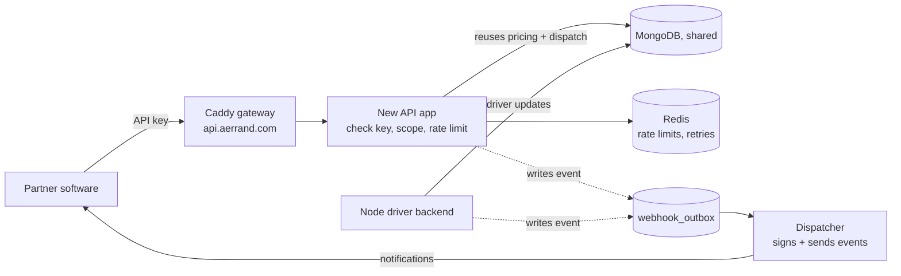

# Initial Setup Report (P1)

**Course:** COMP 8967, University of Windsor, Fall 2026
**Business:** Aerrand Technologies Inc. (Business 3) | **Group:** 6
**Team name:** Keysmiths *(confirm or change)*

> Draft note: keep the final submission to 3 pages. Lines marked *(fill in)* or *(confirm)*
> need the team to check or add something.

## 1. Project Details

### Challenge Description

Aerrand is a Windsor startup that makes buying and selling used items safer. Instead of two
strangers meeting up, a vetted local driver verifies the item, picks it up, and delivers it.
The problem they gave us is this: right now, any business that wants Aerrand to run a delivery
has to log into Aerrand's dashboard and fill out a form by hand. Aerrand wants partners (like
online stores or marketplaces) to be able to do that straight from their own software instead.

The way that happens is through an API key, which is basically a secret token that lets a
partner's code prove who it is and book a delivery automatically. Our job is to build that key
system plus a clean public API around it. The tricky part is doing it safely. Today the price
of a delivery is sent from the browser and the server just trusts it, which is fine when only
Aerrand's own dashboard is calling. The moment outside code can call in, that becomes a hole,
so the server has to work out the price itself. We also can't just add keys onto the old
endpoints, because those weren't built to face the public. So we build a separate, locked-down
entrance that reuses Aerrand's existing pricing and delivery logic but exposes nothing else.

### Solution Approach

**Architecture and design.** We add a new web address for the API and a new, separate section
of the Django backend to handle it, rather than touching the existing code. A request flows
like this:

A few design choices and the trade-offs behind them:

- We keep the new API on its own address and app so a key can book a delivery but can never
  reach the old internal routes. This duplicates a little bit of routing, but it means there's
  no risk to the live dashboard or driver app.
- The server recalculates every price from the stops and distance instead of trusting the
  caller. That costs one extra step, but it closes the "book a delivery for 50 cents" problem.
- For notifications (webhooks), the hard part is that driver updates happen in a separate Node
  service that Django can't see directly. We looked at having Django constantly check the
  database, but that's slow and misses quick changes. Instead, both services write a small
  event row to a shared table, and a background worker reads that table and sends the signed
  notification. It's simpler to test and needs no new infrastructure beyond one worker.

**Implementation strategy.** We work in one-week sprints and try to finish one working piece
end to end each time, instead of building everything half-way at once. Rough milestones:

- Weeks 1–2: project setup, database changes, the API gateway, a health check.
- Weeks 3–4: key creation and login, plus the price-quote endpoint.
- Weeks 5–6: booking a delivery and paying from the wallet, with tracking.
- Weeks 7–8: webhooks and a test/sandbox mode.
- Weeks 9+: safety features (rate limits, retry protection) and developer docs.

### Technologies Chosen

Most of the stack is fixed by the fact that we're plugging into Aerrand's live system, so our
main reason for each is "it's what they already run and we have to integrate with it."

| Technology | Why we're using it | Alternative we skipped |
|-----------|--------------------|------------------------|
| Python / Django | Aerrand's backend is already Django | FastAPI/Flask would split the stack |
| Node.js | The driver backend is Node; our webhook writer lives there | n/a, it's existing |
| MongoDB | Shared database used by all their services | Postgres isn't an option mid-system |
| Redis | Needed for rate limiting and retry state across workers | In-memory cache breaks with multiple workers |
| Caddy | Their existing gateway, handles HTTPS automatically | Nginx, but they standardized on Caddy |
| Docker Compose | Matches their single-server deployment | Kubernetes is overkill here |
| GitHub + Actions | Our repo, issue board, and automated checks | GitLab, but team is on GitHub |
| OpenAPI + Redoc | Auto-generated API docs for partners | Hand-written docs drift out of date |

## 2. Team Details

**Team name:** Keysmiths *(confirm or change)*

Work is split evenly across the four of us by area, and everyone writes code. We review each
other's pull requests, so each person also touches parts outside their main area.

| Member | GitHub | Role / main area |
|--------|--------|------------------|
| Nikhil Goud Nathi (Team Lead) | @nikhilnathi2003 | API keys, authentication, project coordination |
| Sujith Chitram | @sujithchitram24 | Price quotes and delivery booking |
| Venkata Charan Sai Doniparthi | @charansai50 | Wallet payment and webhooks |
| Sai Srinivas Uppara | @Lucky100704 | Tracking/cancellation, dashboard UI and docs |

*Bios (fill in one line each: academic background + technical strengths). Add a headshot next
to each name in the final document.*

**Contribution plan.** Each person owns their area from design through code and tests. The
shared pieces (rate limiting, retry protection, keeping one business's data separate from
another's) are split between pairs and reviewed by everyone. Our GitHub issues are labelled by
area, so it's easy to see who's doing what and that the load is even.

## 3. Team Agreements

- **Primary contact:** Nikhil Goud Nathi (team lead). *(confirm)*
- **Communication:** MS Teams, in the *Business 3 - Group 6* channel, with our GA Rustem
  Izmailov in the chat.
- **Project management:** GitHub Issues and a GitHub Projects board. We've already set up the
  repo and created 102 issues (one per requirement), labelled by priority and area and grouped
  into phase milestones, all on the board.
- **Contingency planning:**
  - If a member drops the course, we split their open issues among the rest at the next sprint
    planning and tell the GA so scope can be adjusted.
  - If someone keeps missing meetings or deadlines, we talk to them directly first; if it keeps
    happening the lead raises it with the GA and we rebalance the board so work isn't blocked.
  - For academic honesty, all work goes through reviewed pull requests with a clear commit
    history, so each person's contribution is traceable. Anything suspicious gets raised with
    the GA and then the instructor.

## 4. Kickoff Meeting Summary

**Business contact:** Johnpaul Sani, Founder and CEO, Aerrand Technologies Inc.

**Questions our team asked** *(answers below are from the technical document Aerrand gave us;
confirm they match what Johnpaul said in the meeting):*

- *(Nikhil)* Will we be working with your real system, or a separate sandbox with sample data?
  **Answer:** We build against the real system, but there's a test mode with "test" keys that
  create fake deliveries (no real driver, no real charge), so we can develop safely.
- *(Nikhil)* Is there an existing wallet system we'd connect to, or should we build a simple
  one? **Answer:** There's already a prepaid wallet for businesses; nothing uses it
  automatically yet, so we connect our API to the existing wallet.
- *(Nikhil)* How would partners receive their API keys, through a dashboard or issued manually
  at first? **Answer:** Through a self-serve "Developers" section in the business dashboard,
  where an approved business creates its own keys.
- *(Teammate)* Should the new API be its own PostgreSQL service, or share the existing MongoDB?
  **Answer:** Share the existing MongoDB; all new data lives in the same shared database.

**Useful questions from other groups:** *(fill in any you noted)*

**Reflection.** Going in, we thought of this mostly as "build some API endpoints." After the
meeting it's clearer that the real challenge is fitting into a system that's already live and
being careful not to break it. The parts that actually need thought are getting the price right
on the server and getting driver updates out across two services, not the endpoints themselves.
That changed what we plan to build first.

## 5. Sprint Plan (one week = one sprint)

**User stories**

- As a partner developer, I want to create an API key from the dashboard so my software can
  connect to Aerrand securely.
- As a partner's system, I want to get a price quote for a route so I know the cost before
  booking.
- As a partner's system, I want to book a delivery in one call and have it paid from our wallet
  so no one has to click "pay" by hand.
- As a partner developer, I want to get a notification when the delivery status changes so I
  don't have to keep checking.
- As Aerrand, I want every key stored safely and revocable instantly so a leaked key does no
  damage.

**Task breakdown for the first four sprints**

| Sprint | Focus | Tasks |
|--------|-------|-------|
| 1 | Setup | Finish this report; set up Docker + Redis; create the new API app skeleton; add a health check; turn on automated checks in GitHub |
| 2 | Keys and login | Build the key model (stored as a hash); check keys on each request; create/revoke key endpoints; dashboard Developers section; write tests |
| 3 | Quotes | Build the quote endpoint using the existing pricing logic; calculate route distance; save quotes with an expiry; add input validation |
| 4 | Booking and payment | Build the create-delivery endpoint (single and multi-stop); pay from the wallet safely; add get/track endpoints; prevent duplicate bookings |

## 6. Other Details

**Risks and assumptions.** The main risk is not getting access to Aerrand's real codebase, so
we're building to the documented interfaces so our code can slot in later. The webhook part is
risky because it spans two services, so we'll prototype it early and test it hard. Pricing has
to match the dashboard exactly, so we'll use Aerrand's own comparison test as a check. We're
assuming we'll get a test business account and wallet to develop against, and that the existing
pricing and delivery logic is stable enough to reuse.

**Ethical considerations.** The system handles personal information (names, phone numbers,
addresses) and payment details. We keep that exposure low: personal info is never written to
logs or error reports, API keys are only ever stored as a hash and never in plain text, webhook
secrets are encrypted, and each business can only ever see its own deliveries. Outgoing webhook
requests are checked so they can't be abused to reach internal addresses. Data handling follows
Canadian privacy rules (PIPEDA) and the business's retention policy.

**Links.**
- Repo: https://github.com/nikhilnathi2003/aerrand-developer-api
- Board: https://github.com/users/nikhilnathi2003/projects/2
